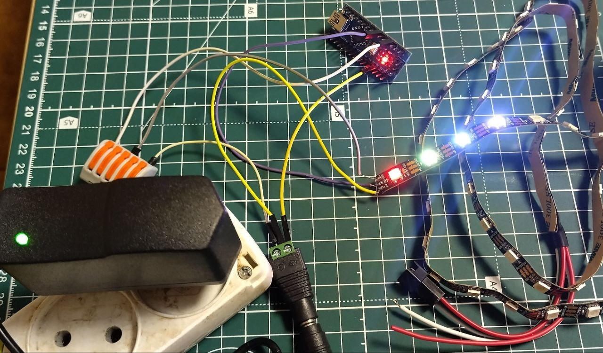
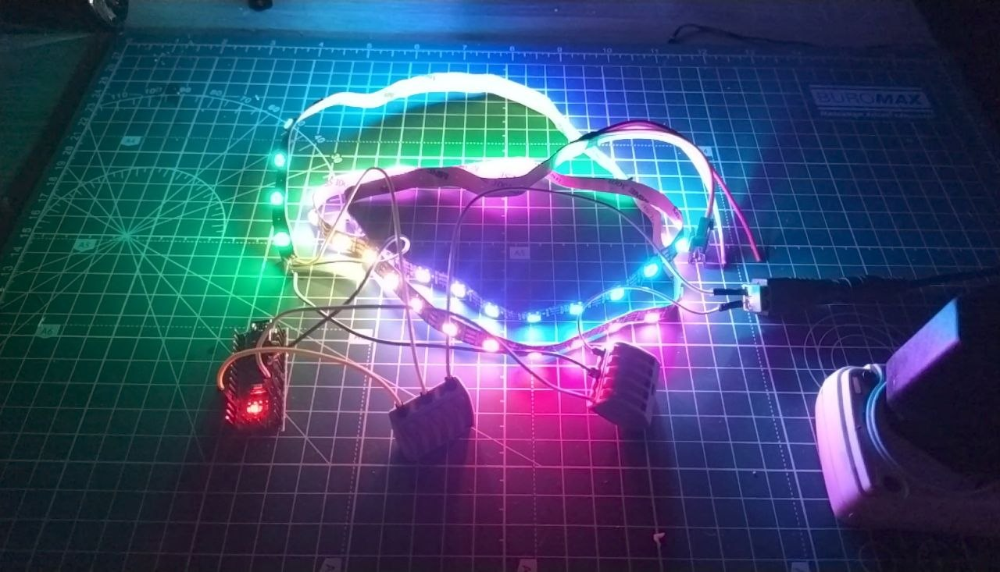

# Arduino Nano LED Strip Controller

Addressable RGB LED strip driven by an Arduino Nano using PlatformIO and FastLED.
This is the first stage of a small embedded project: a motion- and touch-controlled night light.

> **Status:** work in progress.



## Hardware

| Component | Notes |
|---|---|
| Arduino Nano (ATmega328P clone, CH340) | 16 MHz, 2 KB RAM |
| Addressable RGB LED strip | WS2812B, 60 LEDs, 5 V |
| 5 V power supply | USB charger |

## Wiring

| Strip | Connects to |
|---|---|
| 5V | External 5 V supply (+) |
| GND | External supply (-) **and** Arduino GND |
| DIN | Arduino pin D4 |

Notes:

- The strip must be powered from an external 5 V source, not from the Arduino 5V pin. One LED can draw up to ~60 mA at full white.
- GND of the Arduino and the strip must be common.
- Data flows in the direction of the arrows printed on the strip.

## Software

- PlatformIO(https://platformio.org/) (VS Code extension)
- Board: `nanoatmega328`
- Framework: Arduino
- Library: FastLED(https://github.com/FastLED/FastLED) 3.10.9 (pinned in `platformio.ini`)

## Build and upload

```bash
pio run                # build
pio run -t upload      # flash the board
```

On Linux you may need serial port permissions (e.g. add your user to the `uucp` group on Arch-based systems, or `dialout` on Debian/Ubuntu) and the PlatformIO udev rules.

## Configuration

Edit the constants at the top of `src/main.cpp`:

```cpp
#define LED_PIN    4
#define NUM_LEDS   60
#define BRIGHTNESS 50   // 0-255, keep low while testing
```

If colors look wrong (e.g. red shows as green), change the color order in `addLeds` (`GRB`, `RGB`, `BRG`).

## Demo

[](https://youtu.be/RCGIvZtT0HU)

## What works now

- [x] Strip control with FastLED
- [x] First four LEDs set to individual colors (red, yellow, amethyst, blue)
- [x] Non-blocking animations with `millis()` (breathing, running light)
- [x] Mode switching with a state machine

## Roadmap

- [ ] Motion sensor (HC-SR501): light on when someone approaches
- [ ] Touch button (TTP223): switch modes
- [ ] Phone control (Bluetooth or Wi-Fi): color and brightness
- [ ] Battery power (TP4056 + MT3608)

